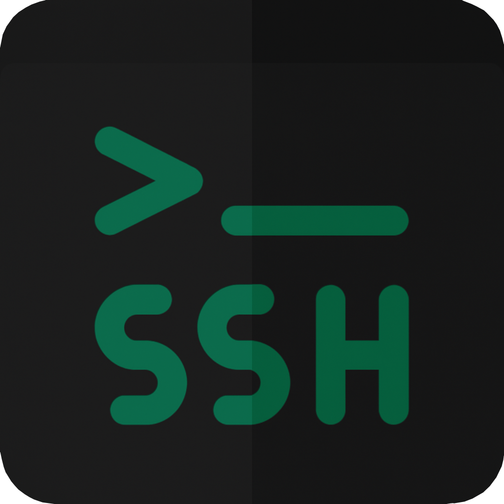

<br>

# sshman
[](https://pkg.go.dev/github.com/sshman-org/sshman)

`sshman` is a small command-line SSH key and connection manager. It keeps your SSH connection profiles **and their private keys** in a single password-encrypted vault file, and connects with OpenSSH without ever writing a private key to disk.

* Vault encrypted with **AES-256-GCM**, key derived with **Argon2id** (t=3, 64 MiB, p=4), with an authenticated, versioned header
* `connect` loads the key into a **private, read-only, per-session agent** that only your `ssh` child process uses; **agent forwarding is always disabled** for it
* Safe vault writes: locked, atomic, fsynced, with an automatic encrypted backup and `restore`
* Generate ed25519 (default) or RSA 3072/4096 keys, or import existing keys (passphrase-protected keys are supported)
* Install a public key on a server (`sendkey`), including password-only servers and key rotation (`--via`)
* Tags, favorites, notes, search, JSON output, explicit exit codes, shell completion
* No daemon, no network service, no telemetry, no cloud sync

---

## Installation

Requires **Go 1.26+** to build (the pinned toolchain is fetched automatically) and the OpenSSH client (`ssh`) in `PATH` for `connect` and `sendkey`.

```bash
git clone https://github.com/sshman-org/sshman.git
cd sshman
go build -trimpath -o sshman .
```

Release binaries are built by CI on demand from a version tag (Actions → Release → Run workflow). Each release ships a `SHA256SUMS` file and a GitHub build-provenance attestation:

```bash
sha256sum -c SHA256SUMS --ignore-missing
gh attestation verify sshman_v*_linux_amd64 --repo sshman-org/sshman
```

### Platform support

| | Linux | macOS | Windows |
|---|---|---|---|
| Vault management, `genkey`, `sendkey` | ✅ tested | ✅ unit-tested in CI | ✅ unit-tested in CI |
| `connect` / `sendkey --via` (vault key via agent) | ✅ tested against sshd | expected to work (same code path; no sshd lab) | ❌ not yet: Win32-OpenSSH needs a named-pipe agent |
| Vault permission checks | ✅ | ✅ | ACLs not checked |

---

## Quick start

```bash
sshman init                                   # create the vault (password ≥ 12 characters)
sshman genkey --name web --user deploy --host web.example.com
sshman sendkey --name web                     # ssh asks for the account password once
sshman connect --name web                     # log in with the vault key
```

Use an existing key instead of generating one:

```bash
sshman add --name db --user admin --host 10.0.0.5 --port 2222 --key ~/.ssh/id_ed25519
cat id_ed25519 | sshman add --name db2 --user admin --host 10.0.0.6 --key -   # from stdin
```

`--key` takes a **file path or `-`** (stdin). Raw key text on the command line is refused, because it would leak through `ps` and shell history. Passphrase-protected keys are decrypted on import (you are prompted) and then protected by the vault. Once the entry works, you can delete the original key file.

---

## Commands

| Command | Purpose |
|---|---|
| `init` | Create an empty vault |
| `add` | Add an entry with an existing private key (`--key FILE\|-`, optional `--pubkey` to verify) |
| `genkey` | Generate a key pair into a new entry; prints the public key (`--type ed25519\|rsa`, `--bits 3072\|4096`) |
| `list` | List entries (`--tag`, `--favorites`, `--key-older-than DAYS`, `--json`) |
| `search -q TEXT` | Search name, user, host and tags (`--json`) |
| `show --name N` | Details, fingerprint and public key; never the private key (`--json`) |
| `pubkey --name N` | Print the public key in `authorized_keys` format |
| `copy --name N` | Copy `ssh user@host [-p port]` to the clipboard |
| `update --name N` | Change `--user --host --port --key --pubkey --tag --notes --favorite` |
| `rename --name N --to M` | Rename an entry |
| `delete --name N` | Delete an entry (asks; `--yes` to skip) |
| `connect --name N [-- CMD…]` | SSH session (or remote command) with the vault key |
| `sendkey --name N [--via M]` | Append the public key to the remote `authorized_keys`, unless already present |
| `passwd` | Change the vault password; re-encrypts with current parameters |
| `restore` | Replace a damaged vault with its automatic backup |
| `doctor` | Check vault location, permissions, format and ssh, without the password |
| `completion bash\|zsh` | Print a shell completion script |

Every command accepts `--vault PATH`; `sshman --vault PATH <command>` also works.

### Host keys

`connect` and `sendkey` follow **your** OpenSSH host-key policy: by default OpenSSH asks you to confirm an unknown host's fingerprint. Pass `--accept-new-host-key` to record an unknown key without asking. A changed key is always refused.

### Key rotation

```bash
sshman list --key-older-than 365                       # find old keys
sshman genkey --name web-2027 --user deploy --host web.example.com
sshman sendkey --name web-2027 --via web               # log in with the old key to install the new one
sshman connect --name web-2027 -- true                 # verify
# remove the old key line from the server's authorized_keys, then:
sshman delete --name web --yes
```

### Scripting

* Prompts and messages go to the terminal or stderr; **stdout carries only data**.
* Passwords are read only from the terminal, never from arguments, environment variables or pipes.
* `--json` gives machine-readable output with no private key material.
* Exit codes: `0` ok, `1` error, `2` invalid usage or input, `3` wrong password or corrupted vault, `4` not found, `5` unsafe vault file or directory, `6` already exists. `connect` returns ssh's own exit status.

---

## Vault file

**Location.** The vault lives at `--vault`, else `$SSHMAN_VAULT`, else the per-user config directory:

* Linux: `~/.config/sshman/vault.vssh`
* macOS: `~/Library/Application Support/sshman/vault.vssh`
* Windows: `%AppData%\sshman\vault.vssh`

**Files kept next to the vault:** `vault.vssh.lock` (an advisory lock) and `vault.vssh.bak` (the previous version, encrypted).

**File safety.** sshman refuses to use a vault that:

* is a symlink,
* is owned by another user,
* is readable or writable by others (fix with `chmod 600`), or
* sits in a world-writable directory without the sticky bit.

A group-writable directory gets a warning.

**Format (v2):**

```
"SSHMAN" | version | kdf | argon2 time | memory KiB | threads | salt length | salt | nonce(12) | AES-256-GCM(JSON)
```

The whole header is authenticated as GCM additional data. Vaults written by older versions (`salt(16) | nonce(12) | ciphertext`) are read and upgraded to v2 on the next change; the old file is kept as `.bak`.

> **Never lose your vault password.** There is no recovery without it.

---

## Security model

**sshman protects** the private keys and host list **at rest**. A stolen vault file costs an attacker one Argon2id evaluation (64 MiB) per password guess, so a long passphrase matters. The vault's integrity is protected (tampering is detected) and it is protected from unsafe filesystem locations.

**While `connect` runs:**

* the decrypted key lives only in sshman's memory and in a read-only agent reachable through a 0600 socket in a 0700 temporary directory;
* only the public key is written to that directory, and the directory is removed when ssh exits;
* the agent answers only "list" and "sign": keys can't be added, removed or locked through it;
* agent forwarding is off even if `~/.ssh/config` says `ForwardAgent yes`;
* your own `SSH_AUTH_SOCK` agent is left untouched.

**sshman does not protect against** malware running as your user or as root: it could read memory, keylog the password or use the agent while a session is open. On Linux, sshman marks itself non-dumpable (blocking same-user ptrace) and disables core dumps on all Unix systems, but Go cannot guarantee that every copy of a secret is erased from memory. Backups or sync tools may keep older copies of the vault, possibly encrypted under an old password.

See [SECURITY.md](SECURITY.md) and the remediation reports in [`docs/remediation/`](docs/remediation/).

---

## Upgrading from earlier versions

* **Vault location:** the default moved from `./vault.vssh` to the config directory. An existing `./vault.vssh` is still used, with a warning, when no vault exists in the new location. Move it there or pass `--vault`.
* **Passwords:** new and changed passwords need at least 12 characters, and whitespace is kept as typed. Existing vaults keep opening, including ones created with leading or trailing spaces (old versions trimmed them). Run `sshman passwd` to set a stronger password and upgrade the vault format.
* **`--key`** no longer accepts raw key text; use a file or `-`.
* **`connect`** no longer auto-accepts unknown host keys (use `--accept-new-host-key`) and no longer forwards the agent.
* **RSA:** `genkey --type rsa` creates 3072 (default) or 4096-bit keys. Existing 2048-bit keys can still be imported.
* **Behaviour:** `delete` asks for confirmation; `list` is sorted; messages go to stderr; duplicate names are rejected.
* **Generated keys** are now in OpenSSH format; existing entries are unaffected.

## Troubleshooting

| Symptom | Fix |
|---|---|
| `unsafe vault location: … permissions 0644` | `chmod 600 <vault>` |
| `… is a symlink` | Pass the real path with `--vault` |
| `incorrect password or corrupted vault` | Check the password; if the file is damaged, run `sshman restore` |
| `Host key verification failed` | Unknown host: connect once interactively and confirm the fingerprint, or use `--accept-new-host-key`. Changed host key: investigate before touching `known_hosts` |
| `a terminal is required to enter the password` | Run from an interactive terminal; sshman never reads passwords from pipes |
| `connect … not supported on Windows yet` | Use WSL, or run `ssh` with a key file for now |
| Anything else | `sshman doctor` |

---

## Dependencies

* [urfave/cli/v2](https://github.com/urfave/cli): CLI framework
* [atotto/clipboard](https://github.com/atotto/clipboard): clipboard support
* [golang.org/x/crypto](https://pkg.go.dev/golang.org/x/crypto): Argon2id, SSH key handling and agent protocol
* [golang.org/x/term](https://pkg.go.dev/golang.org/x/term), [golang.org/x/sys](https://pkg.go.dev/golang.org/x/sys): terminal input, file locking, process hardening
* System: the OpenSSH `ssh` client

## Development

```bash
go test ./...                                   # unit and CLI tests
go test -race ./...
go test -tags integration ./sshutil/            # needs sshd and ssh; starts a throwaway localhost server
go vet ./... && staticcheck ./... && govulncheck ./...
```

See [CONTRIBUTING.md](CONTRIBUTING.md) and [docs/ARCHITECTURE.md](docs/ARCHITECTURE.md).

## Roadmap

Implemented: tags and favorites, rotation helpers, JSON output, `passwd`, `restore`, `doctor`, shell completion.
Next: import hosts from `~/.ssh/config`, per-entry host-key pinning, encrypted export, Windows `connect`.
Evaluated and deferred: TUI, GUI, FIDO2 keys, OS keychain. See [docs/remediation/phase-4-development.md](docs/remediation/phase-4-development.md).

## Contribution

Check [CONTRIBUTING.md](CONTRIBUTING.md).
